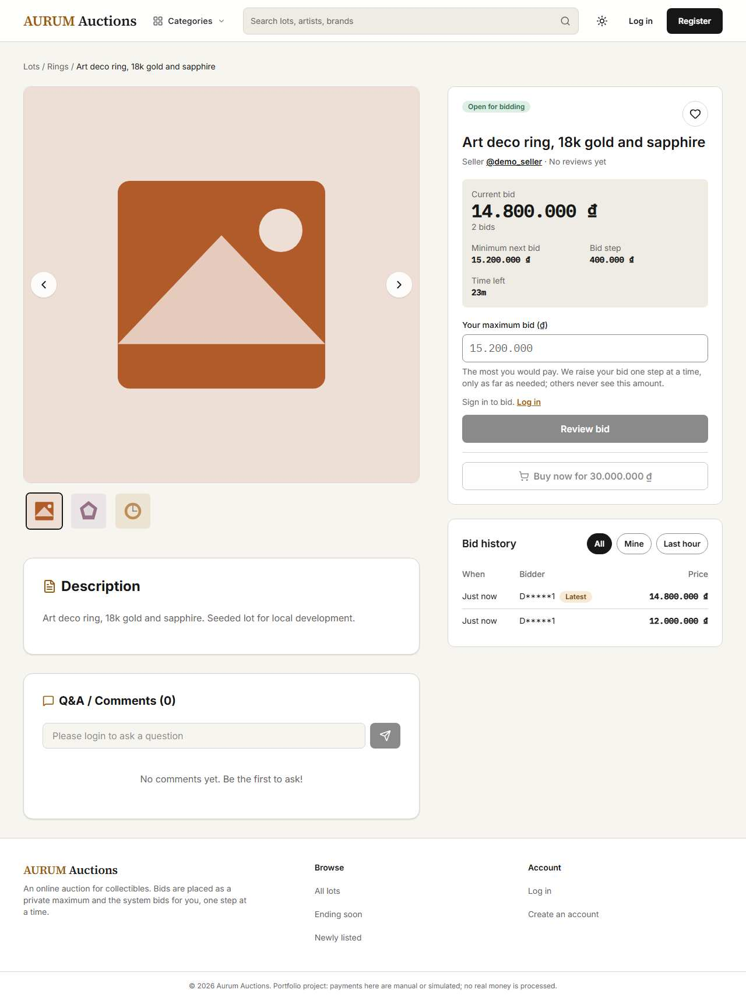
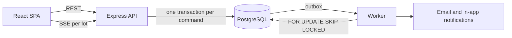

# AURUM Auctions

[](https://github.com/ngothoaidev/Online-Auction/actions/workflows/ci.yml)

An online auction site for collectibles: proxy bidding, auctions that close on their own, orders, live prices and
notifications. Built with React, Express and PostgreSQL.

**Live demo:** https://online-auction-1-a3t4.onrender.com (free Render tier, the first load after idle takes about a minute)

Log in as `demo_buyer1`, `demo_buyer2` or `demo_seller` with password `Passw0rd!demo`. Open the same lot as two
buyers in two browsers to see proxy bidding and live price updates.



Payments are either a manual receipt upload or a mock gateway. No real money is involved.

## Stack

- Frontend: React 19, Vite, Tailwind CSS 4, React Router
- Backend: Node.js, Express, Drizzle ORM, PostgreSQL 16, a separate worker process
- Realtime: Server-Sent Events
- Tests: `node:test` against a real PostgreSQL, Vitest, Playwright
- CI: GitHub Actions. Local setup: Docker Compose

## How it works



PostgreSQL holds everything: state, idempotency keys, the outbox and the audit log. There is no Redis or message broker.

The parts that took the most care:

- **Concurrent bids.** Every bid locks the auction row (`SELECT ... FOR UPDATE`) and checks the deadline against the
  database clock after taking the lock. A test fires 50 concurrent bids at one lot and checks the result equals a
  serial replay.
- **Retries.** Bids carry an `Idempotency-Key` that is stored in the same transaction, so a retried request returns
  the original result instead of bidding twice.
- **Closing auctions.** The worker picks due auctions with `FOR UPDATE SKIP LOCKED`, so several workers can run at
  once, and a unique constraint guarantees one order per auction. Tests kill the worker mid-settlement.
- **Notifications.** Events are written to an outbox table in the same transaction as the change, then delivered by
  the worker with retries. A rolled-back bid never sends an email.
- **Orders.** All status changes go through one pure state-machine function.
- **Money.** Stored as `numeric(15,0)` and handled as `BigInt`, never as floats.

On a laptop, 50 bidders on a single lot got p95 549 ms with no errors; spread over 20 lots it reached 146 req/s
(`backend/scripts/loadtest.js`).

More detail, including the design decisions and the alternatives I rejected: [docs/architecture.md](docs/architecture.md).
API reference: [docs/api.md](docs/api.md). Security notes: [docs/security.md](docs/security.md).

## Running locally

With Docker only:

```bash
docker compose up
```

Open http://localhost:5173 once the `api` container is healthy. The seed also creates `demo_admin` (same password)
locally.

Or with Node 22.18+ and Docker for the database:

```bash
docker compose up -d db

cd backend
cp .env.example .env
npm ci
npm run db:migrate && npm run db:seed
npm run dev        # API on :3000
npm run worker     # second terminal

cd ../frontend
cp .env.example .env
npm ci
npm run dev        # http://localhost:5173
```

## Tests

```bash
cd backend && npm run lint && npm run test:unit && npm run test:integration   # needs the db container
cd frontend && npm run lint && npm test && npm run build
cd frontend && npx playwright test                                            # needs API, worker and Vite running
```

Integration tests only run against a database whose name ends in `_test`.

## Not done yet

- A real payment provider sandbox
- Google/Facebook login tested with production credentials
- SSE fan-out across several API instances
