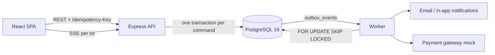

# AURUM Auctions — online auction for collectibles

[](https://github.com/ngothoaidev/Online-Auction/actions/workflows/ci.yml)

**Live:** [online-auction-1-a3t4.onrender.com](https://online-auction-1-a3t4.onrender.com/) ·
API [health](https://online-auction-uf4s.onrender.com/health/ready) ·
[OpenAPI spec](https://online-auction-1-a3t4.onrender.com/openapi.json)
<sub>(free Render tier: the first request after idle can take ~1 minute)</sub>

**Try it:** log in as `demo_buyer1` or `demo_buyer2` (bidder) or `demo_seller`, password `Passw0rd!demo`.
Open the same lot as two buyers in two browsers to watch proxy bidding and live prices.

A full-stack auction site built to behave correctly under concurrency: proxy bidding that is serialized per lot,
auctions that close by themselves, an order lifecycle with a real state machine, live prices, notifications,
moderation with an audit trail — and the tests, measurements and runbooks that show it.

**Stack:** React 19 + Vite + Tailwind 4 (SPA) · Node.js + Express · PostgreSQL 16 + Drizzle ORM · a separate worker
process · Server-Sent Events · Playwright, Vitest, `node:test` against a real PostgreSQL · Docker Compose · GitHub Actions.

<p align="center">
  
</p>

> Portfolio project. Payments are **manual** (the buyer uploads a receipt) or go through a **mock gateway** — no real
> money is processed anywhere.

## Architecture



PostgreSQL is the single source of truth: state, idempotency keys, outbox, audit log and worker heartbeats all live
there, so there is no Redis or message broker to keep consistent. Details: [docs/architecture.md](docs/architecture.md).

## Hard problems and how they are solved

| Problem | Solution | Proof |
|---|---|---|
| Two bidders hit the same lot in the same millisecond | `SELECT … FOR UPDATE` on the auction row; deadline and proxy math decided on `clock_timestamp()` *after* the lock | 50-way concurrent bid test on real PostgreSQL |
| Client retries a bid after a timeout | `Idempotency-Key` claimed in the same transaction; replays return the stored result, a different payload gets `409` | `bidding.test.js` |
| An auction must close with nobody online, exactly once | Worker claims due lots with `FOR UPDATE SKIP LOCKED`, re-checks under the lock; `UNIQUE(orders.auction_id)` as the last guard | Several workers in parallel + process kill mid-settlement |
| Email/notification must not be lost or sent for a rolled-back bid | Transactional outbox; dispatcher leases rows, uses `attempts` as fencing token, backs off and dead-letters | `outbox.test.js` |
| Order status edited from many places | One pure-function state machine for every transition | `orderTransitions.test.js` |
| Money rounding | Integer minor units as `BigInt` end to end | `money.test.js` |

**Measured** (single laptop, [report](docs/validation/report-t23.md)): 50 bidders on one lot — p95 549 ms, 0 errors;
50 bidders over 20 lots — 146 req/s, p95 263 ms; catalog reads — 396 req/s, p95 89 ms.

## What it does

| | |
|---|---|
| **Bidding** | Private maximum ("proxy") bids, raised one step at a time; ties go to the earlier maximum; anti-sniping extension. Every bid on a lot is serialized by a row lock and decided on the database clock; retries are idempotent. |
| **Closing** | A worker settles due auctions with nobody watching, creates exactly one order, and skips banned/disqualified bidders. Buy Now ends a lot atomically. |
| **Orders** | One state machine for every change: manual proof or mock-gateway payment, payment deadline + expiry, shipping, receipt, two-sided reviews; private proof uploads. |
| **Live** | Per-lot Server-Sent Events from committed events; the countdown follows the server clock; honest "offline/paused" labels and automatic catch-up. |
| **Notifications** | In-app + email from a transactional outbox (outbid, won, sold, payment, shipped, completed, reminders), deduplicated per recipient. |
| **Moderation** | Listing reports, ban/role/seller approval/category/listing actions as audited, idempotent admin commands; append-only audit log. |
| **Operations** | JSON logs with redaction, `/health/live`, `/health/ready`, Prometheus `/metrics`, worker heartbeat, runbooks. |

Full list with evidence: [docs/feature-matrix.md](docs/feature-matrix.md).

## Quick start

### Option A — Docker Compose (everything in containers)

```bash
docker compose up            # db + api (migrate + seed) + worker + frontend
```
Open http://localhost:5173 when `api` is healthy (first start installs packages; a few minutes).

### Option B — local Node (faster inner loop)

Requires Node ≥ 20 (developed on 24) and Docker for PostgreSQL.

```bash
docker compose up -d db                       # PostgreSQL on localhost:55432 (databases auction + auction_test)

cd backend
cp .env.example .env                          # placeholders are fine for local use
npm ci
npm run db:migrate && npm run db:seed         # seed is idempotent; re-run it to get fresh lots when all have closed
npm run dev                                   # API  -> http://localhost:3000
npm run worker                                # in a second terminal: settlement, payments, reminders, outbox

cd ../frontend
cp .env.example .env                          # VITE_API_URL=http://localhost:3000
npm ci
npm run dev                                   # SPA  -> http://localhost:5173
```

### Demo accounts (seed)

| Role | Username | Password |
|---|---|---|
| Buyer | `demo_buyer1`, `demo_buyer2` | `Passw0rd!demo` |
| Seller | `demo_seller` | `Passw0rd!demo` |
| Admin | `demo_admin` | `Passw0rd!demo` |

A guided 10-minute walkthrough (two bidders, disconnect/retry, automatic close, payment, shipping, reviews, one
concurrency and one crash/recovery proof): **[docs/demo.md](docs/demo.md)**.

## Tests and checks

| | Command | Notes |
|---|---|---|
| Backend lint / unit | `cd backend && npm run lint && npm run test:unit` | |
| Backend integration | `npm run test:integration` | Real PostgreSQL, database `auction_test`; refuses any DB not named `*_test`. Includes 50-way concurrent bidding, races, real worker process kills. |
| Frontend lint / unit / build | `cd frontend && npm run lint && npm test && npm run build` | |
| End-to-end | `cd frontend && npx playwright test` | Needs API + worker + Vite running; start the API with `AUTH_/BID_/UPLOAD_/COMMENT_RATE_LIMIT_MAX` raised. |
| Accessibility / reflow / screenshots | `node scripts/qa-a11y.mjs`, `qa-reflow.mjs`, `qa-screenshots.mjs <label>` | Real Chromium; see `docs/validation/`. |
| Load | `cd backend && node scripts/loadtest.js` | Use a dedicated DB; see the header of the script. |

CI (`.github/workflows/ci.yml`): backend (lint, unit, integration on PostgreSQL), frontend (lint, unit, build), e2e (full stack + Playwright).
Latest measured results: [docs/validation/report-t23.md](docs/validation/report-t23.md).

## Documentation

| | |
|---|---|
| [docs/architecture.md](docs/architecture.md) | Components, data model, command/transaction flow, outbox, realtime, worker, state machines |
| [docs/api.md](docs/api.md) | Endpoints, auth, error envelope, idempotency, SSE format, webhooks, health/metrics |
| [docs/security.md](docs/security.md) | Threat model notes and the controls in place |
| [docs/runbook.md](docs/runbook.md) | Worker lag, stuck outbox, payment exceptions, legacy proofs, recovery, cutover/rollback |
| [docs/deployment.md](docs/deployment.md) | Production deployment (Render: API + worker + static site) and its requirements |
| [docs/adr/](docs/adr/) | Business policies (0001) and architecture decisions (0002) |
| [docs/validation/](docs/validation/) | Test/QA/performance evidence and screenshots |
| `.kiro/specs/online-auction-upgrade/` | Requirements, design and task plan of the upgrade (kept outside version control) |

## Repository layout

```
backend/   Express API (app.js, server.js), worker (worker.js, jobs/), domain/ (pure rules), services/ (commands),
           db/schema.js + drizzle/ (migrations), adapters/payments/, scripts/, tests/{unit,integration}
frontend/  React SPA: pages/, components/ui (accessible primitives), hooks/ (useAuction, useAuctionEvents), services/, e2e/
docs/      architecture, API, security, runbook, ADRs, validation evidence
```

## Status and known limits

Deployed on Render (free tier). Not yet done: a real payment-provider sandbox (payments are manual or mocked),
OAuth verified with production credentials, load numbers from production-like hardware (current ones come from one
laptop), and multi-instance SSE fan-out. Full list with evidence: [docs/feature-matrix.md](docs/feature-matrix.md).
