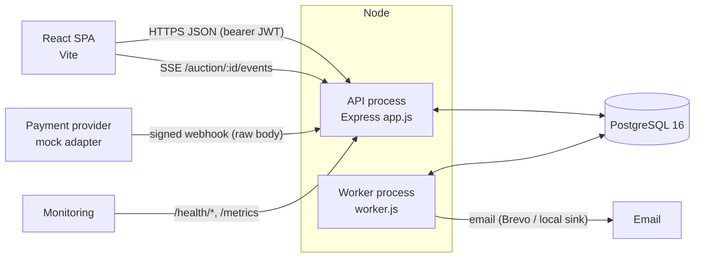
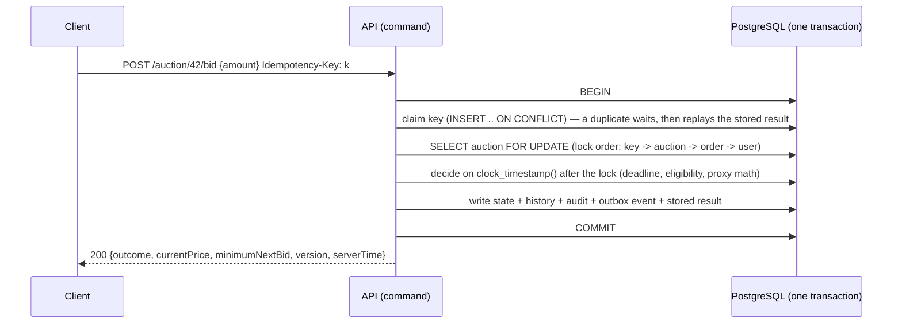
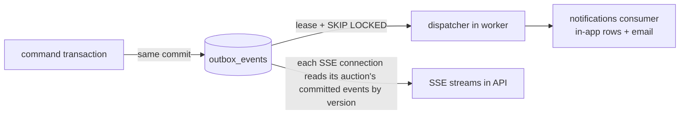
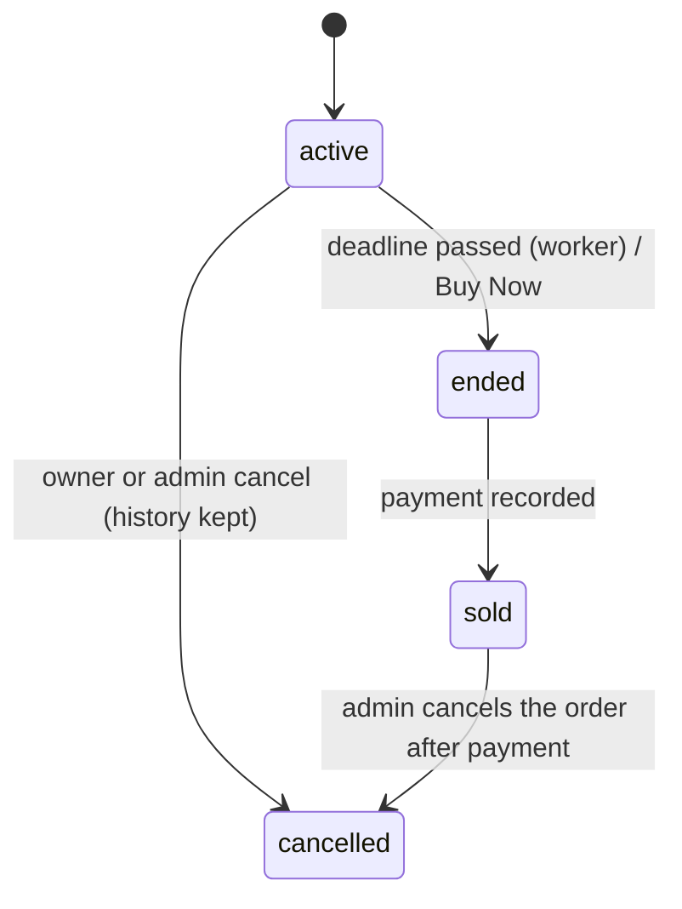
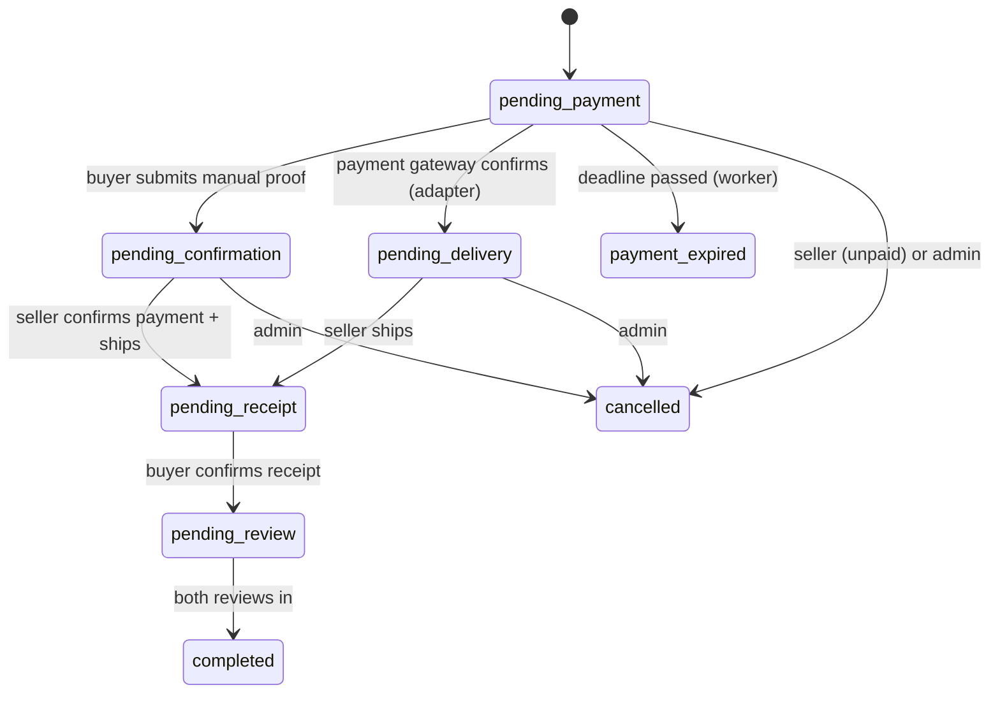

# Architecture

## 1. Components

- **API** (`backend/app.js`, `server.js`): HTTP + SSE. Stateless apart from per-process metrics and open SSE streams; can run as several instances.
- **Worker** (`backend/worker.js`): one loop running jobs in order — settlement, payment reconciliation, payment expiry, payment reminders, media cleanup, outbox dispatch. Several workers may run at once: every job claims work with row locks (`FOR UPDATE SKIP LOCKED` or leases). It never imports the HTTP app.
- **PostgreSQL** is the single source of truth: state, history, idempotency keys, audit, outbox, heartbeats.

Code layout in `backend/`: `domain/` holds pure rules (bidding math, eligibility, money, order transitions) with no I/O; `services/*Commands.js` are the only places that change state; `routes/` + `controllers/` are thin HTTP adapters; `jobs/` are worker steps; `adapters/payments/` isolates the provider.

## 2. Data model (main tables)

| Area | Tables |
|---|---|
| Accounts | `users` (role, status, `auth_version` for token revocation, rating counters), `auth_challenges` (purpose-scoped OTP/reset grants), `seller_requests` |
| Catalog | `categories` (parent/child), `auctions` (price, `version`, `command_sequence`, `winner_id`, `settled_at`, `close_reason`), `auction_images`, `description_logs`, `comments`, `user_favorites` |
| Bidding | `bidder_maxima` (private ceilings, `priority_sequence`, disqualification), `bids` (public price history, typed: bid/buy_now/adjust, `invalidated_at`), `auction_command_audit` |
| Orders | `orders` (state, `version`, `payment_due_at`, `payment_mode`), `order_transitions` (append-only), `media_assets` (private proofs), `order_messages`, `reviews` |
| Payments | `payment_attempts` (server amount, provider status, exception reason), `payment_events` (deduplicated provider events) |
| Reliability | `command_requests` (idempotency keys + stored results), `outbox_events` (domain events, leases, retries, dead letters), `worker_heartbeats` |
| Notifications / moderation | `notifications` (unique per recipient+channel+event), `listing_reports`, `admin_audit` (append-only by trigger) |

Money is `numeric(15,0)` in the database, `BigInt` in the domain and a digit string in JSON — never a float.

## 3. How a command runs

Every state change follows the same shape (`services/auctionCommands.js`, `orderCommands.js`, `payments.js`, `moderation.js`):

Nothing external (email, provider calls) happens inside the transaction. Retrying with the same key returns the stored result; the same key with a different payload is `409 IDEMPOTENCY_CONFLICT`.

## 4. Proxy bidding (D4)

Each bidder has one private maximum. The public price is `max(start, min(topMax, secondMax + step))`; equal maxima are won by the earlier `priority_sequence`; a leader raising their own maximum changes neither price nor deadline. A public price change inside the last 5 minutes extends the lot once by 5 minutes when `auto_extend` is on. Rejecting a bidder (seller) disqualifies their maximum and recomputes leader and price from the remaining ceilings (price may go down — recorded as an `adjust` bid). Pure engine: `domain/bidding.js`.

## 5. Events: outbox → consumers and live updates

- **Dispatcher** (`services/outbox.js`): claims committed events under a lease (`attempts` is the fencing token), calls consumers, marks delivered; failures back off exponentially and dead-letter after 10 attempts. Delivery is **at least once**; consumers dedupe by event id.
- **Notifications** (`services/notifications.js`): unique per `(recipient, channel, eventId:kind)`; email failures make the outbox retry; a crash after the provider accepted a message can resend it (documented, tested in `faults.test.js`).
- **Realtime** (`services/realtime.js`): SSE ids are `auctionId:version`; `Last-Event-ID` replays what was missed; too far behind ⇒ `reset` and the client refetches. Every API instance reads the outbox itself, so no event is "consumed" away from another instance. Public payload only: `{auctionId, version, status, currentPrice, bidCount, endTime, serverTime}`.

## 6. Worker jobs

| Job | Claims work with | Result |
|---|---|---|
| `settleDue` | `FOR UPDATE SKIP LOCKED` on due active auctions, re-checked under the lock | `ended` + exactly one order (UNIQUE `orders.auction_id`) + `auction.ended` event; banned/disqualified bidders skipped (B12) |
| `reconcilePayments` | open payment attempts older than `PAYMENT_RECONCILE_AFTER_MS` | asks the provider; applies through the same deduplicated path as webhooks |
| `expirePayments` | `pending_payment` orders past `payment_due_at` | `payment_expired` through the state machine; a late payment becomes an exception, never reopens |
| `paymentReminders` | orders due within 24 h / 2 h | one outbox reminder per order per window |
| `cleanupMedia` | unattached uploads past TTL | file + row removed |
| `dispatchOutbox` | leased outbox rows | consumers run, rows marked or retried |

Each pass ends with a heartbeat row (`worker_heartbeats`); `/health/ready` and `/metrics` read it.

## 7. State machines

### Auction

`close_reason`: `ended`, `buy_now`, `no_bids`, `no_eligible_bidder`, `cancelled`, `order_cancelled`, `cancelled_after_payment`.

### Order (`domain/orderTransitions.js`)

Every transition is written to `order_transitions` with actor and reason, bumps `orders.version` (clients may send `expectedVersion`), and emits `order.<status>`. An order uses one payment mode: manual proof **or** the gateway.

## 8. Observability

JSON logs on stdout/stderr (`utils/log.js`, keys such as password/token/email/address/maximum/proof redacted), request id per request (incoming `X-Request-Id` kept when well-formed), `GET /health/live`, `GET /health/ready` (DB + migrations; worker reported), `GET /metrics` (Prometheus text: HTTP rate/latency per route pattern, auction lock wait, overdue unsettled auctions, settlement lag p95, outbox backlog/retries/dead letters, payment exceptions, email delivery failures, worker heartbeat age, SSE connections). Operating procedures: [runbook.md](runbook.md).

## 9. Decisions

Business policies: [adr/0001-business-policies.md](adr/0001-business-policies.md). Technical decisions and their alternatives: [adr/0002-architecture-decisions.md](adr/0002-architecture-decisions.md).
